# 你好，我是 KFACBT

**Anyway, keep learning.**

   

---

## 关于我

独立开发者，GitHub ID `gytxtx`。写东西的动机一直很朴素：**日常里哪个环节别扭，就把它做成工具。**

最近的精力主要落在 [Cafe Launcher](https://github.com/bluearchive-cafe/Cafe.Launcher.Avalonia)：一个面向 Blue Archive 日服的跨平台桌面启动器，以及围绕它的后端、下载镜像和文档站。除此之外，手上的项目大致分四类：

- **桌面与移动应用** —— 直接对接系统能力与真实硬件，而不是包一层网页（C# / .NET · Kotlin）
- **服务与站点** —— 后端、下载镜像、博客和文档都自己搭（Cloudflare Workers · Astro · VitePress）
- **Agent 工具链** —— 让 AI Agent 能观察并操作真实桌面（C# · Windows UI Automation）
- **游戏 Mod** —— 给喜欢的游戏补上想要的功能（Godot / GDScript）

空闲之余也会写博客：<https://blog.gytxtx.top/>

---

## 最近在做

- **[Cafe Launcher](https://github.com/bluearchive-cafe/Cafe.Launcher.Avalonia) v1.4.0 测试版** —— 补齐 Linux 运行环境设置、视频背景与更新镜像回退，重写用户协议与隐私政策
- **[Blog_Astro](https://github.com/gytxtx/Blog_Astro)** —— 博客从 MkDocs 迁移到 Astro，改由 Cloudflare Workers 托管
- **[etn-mods](https://github.com/gytxtx/etn-mods)** —— 为《Enter The Nyangeon》维护修改器与 EasyTier 联机组网 Mod
- **[kagami-desktop](https://github.com/gytxtx/kagami-desktop) / [OpenJBD](https://github.com/gytxtx/OpenJBD)** —— 继续维护 Windows 桌面 Agent CLI 与 Android BMS 仪表板

---

## 技术栈

**语言**

       

**框架与平台**

       

---

## 代表项目

### 个人项目

  <a href="https://github.com/gytxtx/OpenJBD">
    <picture>
      <source media="(prefers-color-scheme: dark)" srcset="https://raw.githubusercontent.com/gytxtx/gytxtx/readme-assets/profile/pin-openjbd-dark.svg" />
      <source media="(prefers-color-scheme: light)" srcset="https://raw.githubusercontent.com/gytxtx/gytxtx/readme-assets/profile/pin-openjbd.svg" />
      
    </picture>
  </a>
  <a href="https://github.com/gytxtx/kagami-desktop">
    <picture>
      <source media="(prefers-color-scheme: dark)" srcset="https://raw.githubusercontent.com/gytxtx/gytxtx/readme-assets/profile/pin-kagami-desktop-dark.svg" />
      <source media="(prefers-color-scheme: light)" srcset="https://raw.githubusercontent.com/gytxtx/gytxtx/readme-assets/profile/pin-kagami-desktop.svg" />
      
    </picture>
  </a>

另外还在维护 [Blog_Astro](https://github.com/gytxtx/Blog_Astro)（Astro 博客）、[etn-mods](https://github.com/gytxtx/etn-mods)（Godot Mod）和 [skills](https://github.com/gytxtx/skills)（Agent 开发 Skill）。

### 参与共建 · 蔚蓝咖啡厅

[蔚蓝咖啡厅](https://github.com/bluearchive-cafe) 是我参与共建的 Blue Archive 汉化社区组织，我主要在做启动器及其配套服务：

  <a href="https://github.com/bluearchive-cafe/Cafe.Launcher.Avalonia">
    <picture>
      <source media="(prefers-color-scheme: dark)" srcset="https://raw.githubusercontent.com/gytxtx/gytxtx/readme-assets/profile/pin-cafe-launcher-dark.svg" />
      <source media="(prefers-color-scheme: light)" srcset="https://raw.githubusercontent.com/gytxtx/gytxtx/readme-assets/profile/pin-cafe-launcher.svg" />
      
    </picture>
  </a>
  <a href="https://github.com/bluearchive-cafe/frontend-new">
    <picture>
      <source media="(prefers-color-scheme: dark)" srcset="https://raw.githubusercontent.com/gytxtx/gytxtx/readme-assets/profile/pin-frontend-new-dark.svg" />
      <source media="(prefers-color-scheme: light)" srcset="https://raw.githubusercontent.com/gytxtx/gytxtx/readme-assets/profile/pin-frontend-new.svg" />
      
    </picture>
  </a>

  <a href="https://github.com/bluearchive-cafe/dashboard">
    <picture>
      <source media="(prefers-color-scheme: dark)" srcset="https://raw.githubusercontent.com/gytxtx/gytxtx/readme-assets/profile/pin-dashboard-dark.svg" />
      <source media="(prefers-color-scheme: light)" srcset="https://raw.githubusercontent.com/gytxtx/gytxtx/readme-assets/profile/pin-dashboard.svg" />
      
    </picture>
  </a>

同一组织下的 [Cafe.Launcher.Backend](https://github.com/bluearchive-cafe/Cafe.Launcher.Backend)（更新与公告 API）、[Cafe.Launcher.Downloads](https://github.com/bluearchive-cafe/Cafe.Launcher.Downloads)（R2 下载镜像与统计）、[docs](https://github.com/bluearchive-cafe/docs)（VitePress 文档站）和 [Cafe.Launcher.Next](https://github.com/bluearchive-cafe/Cafe.Launcher.Next)（多游戏分支）也在持续维护。

---

## GitHub 数据

  <picture>
    <source media="(prefers-color-scheme: dark)" srcset="https://raw.githubusercontent.com/gytxtx/gytxtx/readme-assets/profile/stats-dark.svg" />
    <source media="(prefers-color-scheme: light)" srcset="https://raw.githubusercontent.com/gytxtx/gytxtx/readme-assets/profile/stats.svg" />
    
  </picture>
  <picture>
    <source media="(prefers-color-scheme: dark)" srcset="https://raw.githubusercontent.com/gytxtx/gytxtx/readme-assets/profile/top-langs-dark.svg" />
    <source media="(prefers-color-scheme: light)" srcset="https://raw.githubusercontent.com/gytxtx/gytxtx/readme-assets/profile/top-langs.svg" />
    
  </picture>

  <picture>
    <source media="(prefers-color-scheme: dark)" srcset="https://raw.githubusercontent.com/gytxtx/gytxtx/readme-assets/profile/streak-dark.svg" />
    <source media="(prefers-color-scheme: light)" srcset="https://raw.githubusercontent.com/gytxtx/gytxtx/readme-assets/profile/streak.svg" />
    
  </picture>

---

## 贡献图

<picture>
  <source media="(prefers-color-scheme: dark)" srcset="https://raw.githubusercontent.com/gytxtx/gytxtx/readme-assets/profile/github-contribution-grid-snake-dark.svg" />
  <source media="(prefers-color-scheme: light)" srcset="https://raw.githubusercontent.com/gytxtx/gytxtx/readme-assets/profile/github-contribution-grid-snake.svg" />
  
</picture>

---

## 其他平台

 

